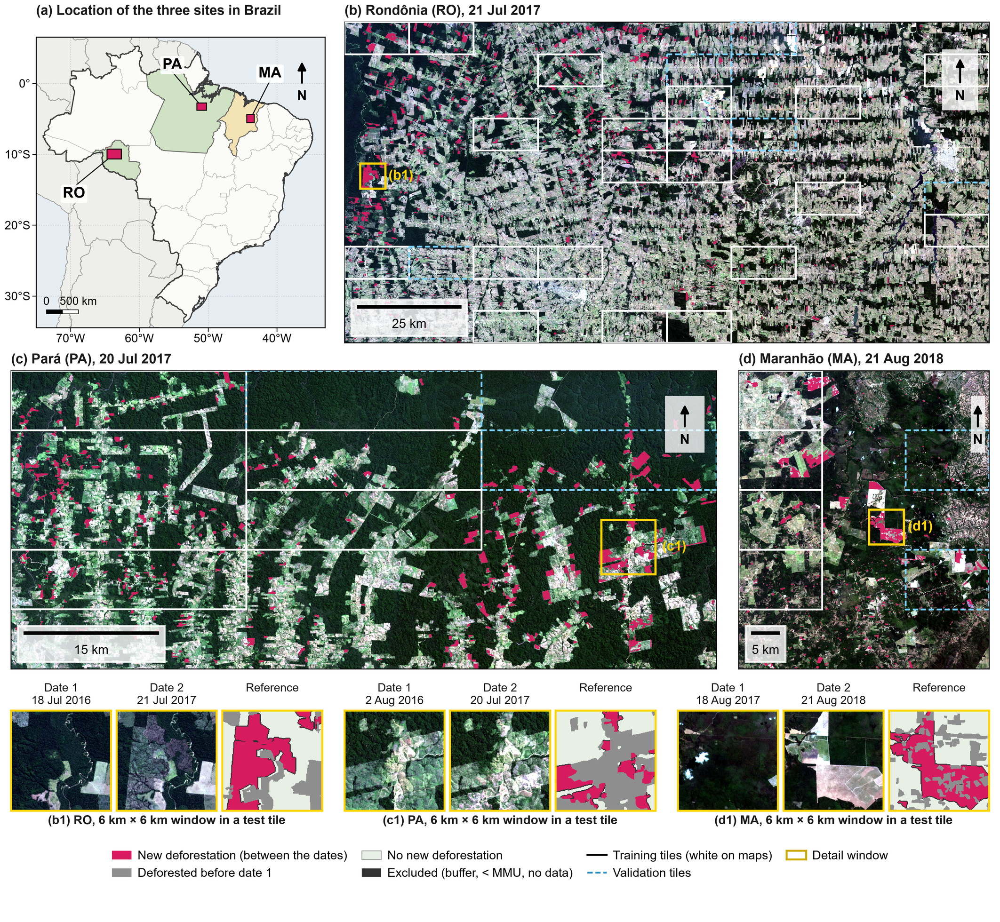
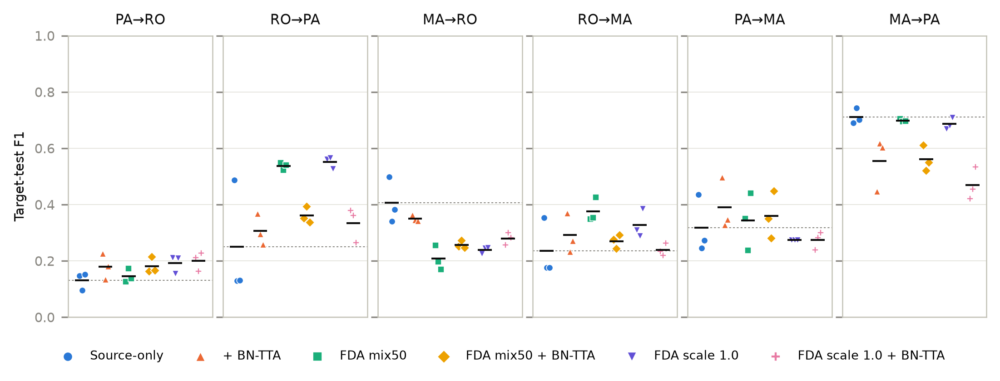
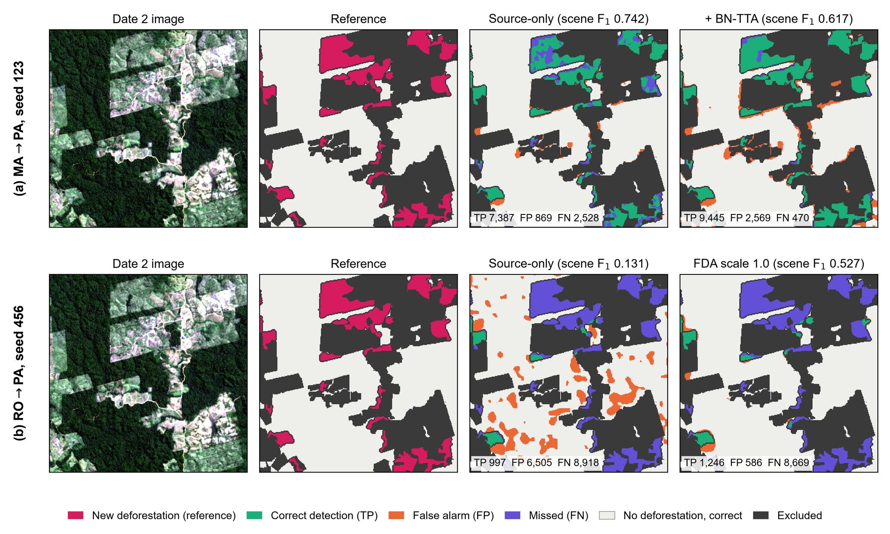
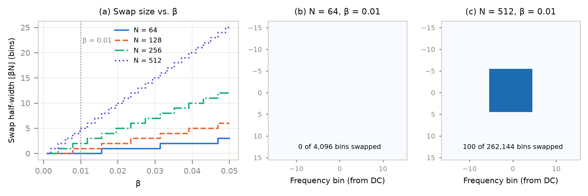
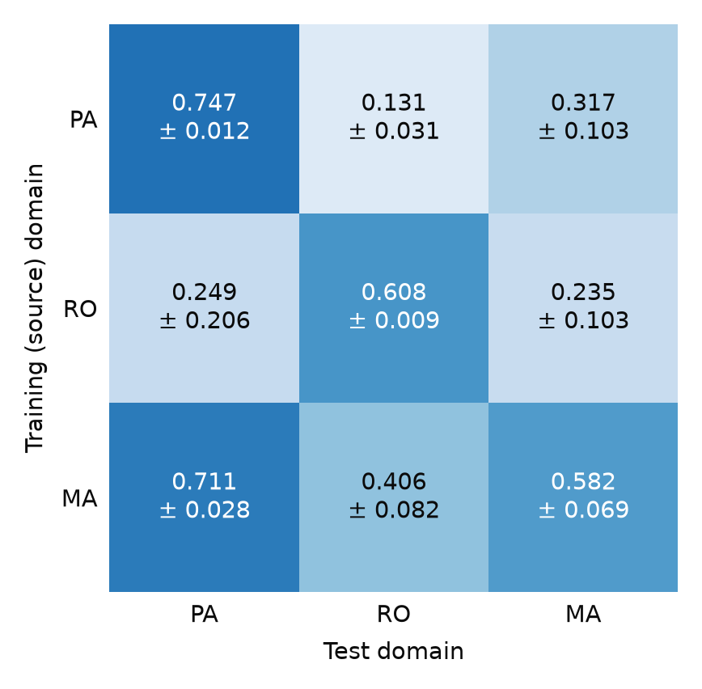
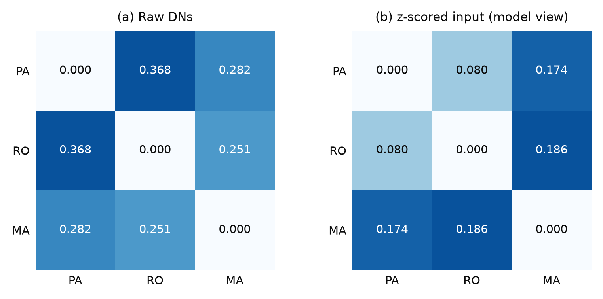
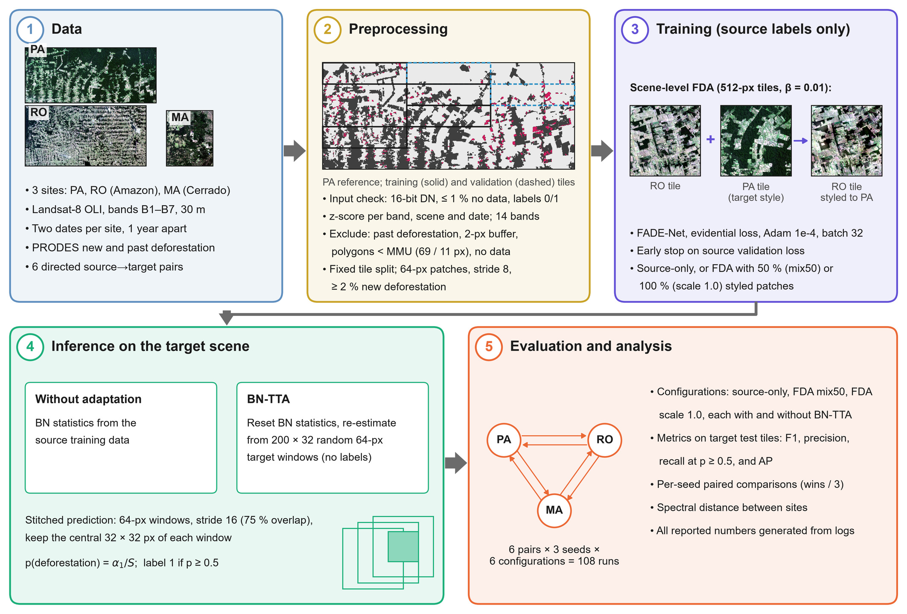
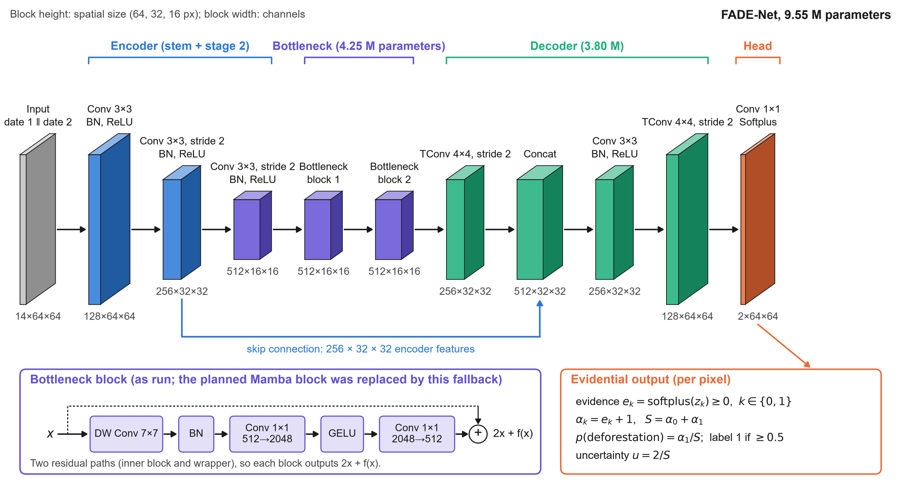

# How much do simple domain adaptation methods help cross-biome deforestation detection?

**A multi-seed evaluation on Landsat-8.** Code, per-run results and paper source.


<sub>The three Landsat-8 sites: Pará (PA) and Rondônia (RO) in the Amazon, Maranhão (MA) in the
Amazon–Cerrado transition, with the reference new deforestation (magenta), the training and validation tiles,
and 6 × 6 km detail windows. Every figure in this repository is drawn in code from the study data.</sub>

## What this study asks

Deep change-detection models trained on one region lose accuracy on another. Two adaptation methods are
cheap enough to try first: re-estimating batch-normalization statistics on the target scene at test time
(**BN-TTA**), and restyling the source images with the low-frequency spectrum of the target
(**Fourier Domain Adaptation, FDA**). How much do they actually help, and how reliably?

We evaluate all **6 directed source → target pairs × 3 seeds × 6 configurations = 108 runs**, reporting
F1, precision and recall at a fixed threshold, and threshold-free average precision (AP).

## Main findings

- **Transfer is strongly directional, and seeds matter.** Without adaptation, target F1 ranges from
  0.131 (PA→RO) to 0.711 (MA→PA). For RO→PA, three seeds of an otherwise identical run give
  0.130 to 0.487, as wide as most method effects.
- **BN-TTA improves ranking more reliably than thresholded accuracy.** It raises AP in 14 of
  18 paired runs (mean +0.077) but F1 in only 12 of 18 (mean
  +0.004). On the pairs trained on MA it raises recall, lowers precision, and F1 falls.
- **FDA at β = 0.01 does nothing on 64 × 64 patches**: the swap window is empty. Applied to 512 × 512 scene
  tiles, it raises F1 in 5 of 6 paired runs when training on RO (mean
  +0.214) and lowers it in 5 of 6 when training on MA.
- **No configuration is best on every pair**; for both MA-source pairs the unadapted model is best.

<p align="center"></p>
<sub>Target F1 per seed (markers) and mean (black tick) for every method and pair; the dashed line is the
source-only mean.</sub>

### Target-domain F1 (mean ± std over seeds 42, 123, 456; bold = best per pair)

| Method | PA→RO | RO→PA | MA→RO | RO→MA | PA→MA | MA→PA |
|---|---:|---:|---:|---:|---:|---:|
| Source-only | 0.131 ± 0.031 | 0.249 ± 0.206 | **0.406 ± 0.082** | 0.235 ± 0.103 | 0.317 ± 0.103 | **0.711 ± 0.028** |
| + BN-TTA | 0.180 ± 0.046 | 0.307 ± 0.056 | 0.351 ± 0.011 | 0.291 ± 0.070 | **0.390 ± 0.093** | 0.555 ± 0.095 |
| FDA mix50 | 0.145 ± 0.025 | 0.537 ± 0.014 | 0.208 ± 0.044 | **0.376 ± 0.043** | 0.343 ± 0.101 | 0.699 ± 0.005 |
| FDA mix50 + BN-TTA | 0.181 ± 0.029 | 0.360 ± 0.029 | 0.257 ± 0.013 | 0.270 ± 0.025 | 0.359 ± 0.084 | 0.561 ± 0.047 |
| FDA scale 1.0 | 0.191 ± 0.032 | **0.551 ± 0.021** | 0.239 ± 0.012 | 0.328 ± 0.051 | 0.274 ± 0.000 | 0.686 ± 0.020 |
| FDA scale 1.0 + BN-TTA | **0.201 ± 0.033** | 0.334 ± 0.061 | 0.280 ± 0.022 | 0.239 ± 0.022 | 0.274 ± 0.031 | 0.470 ± 0.058 |

### Target-domain average precision (AP)

| Method | PA→RO | RO→PA | MA→RO | RO→MA | PA→MA | MA→PA |
|---|---:|---:|---:|---:|---:|---:|
| Source-only | 0.107 ± 0.018 | 0.286 ± 0.205 | 0.393 ± 0.065 | 0.395 ± 0.143 | 0.742 ± 0.015 | **0.801 ± 0.017** |
| + BN-TTA | 0.152 ± 0.042 | 0.515 ± 0.072 | **0.524 ± 0.036** | **0.484 ± 0.108** | **0.742 ± 0.010** | 0.769 ± 0.049 |
| FDA mix50 | 0.116 ± 0.028 | 0.626 ± 0.048 | 0.160 ± 0.022 | 0.370 ± 0.054 | 0.595 ± 0.044 | 0.791 ± 0.001 |
| FDA mix50 + BN-TTA | 0.154 ± 0.040 | **0.636 ± 0.031** | 0.232 ± 0.008 | 0.404 ± 0.102 | 0.597 ± 0.048 | 0.778 ± 0.025 |
| FDA scale 1.0 | 0.141 ± 0.020 | 0.614 ± 0.021 | 0.169 ± 0.018 | 0.378 ± 0.044 | 0.527 ± 0.039 | 0.773 ± 0.019 |
| FDA scale 1.0 + BN-TTA | **0.163 ± 0.019** | 0.586 ± 0.027 | 0.241 ± 0.041 | 0.348 ± 0.039 | 0.503 ± 0.043 | 0.729 ± 0.037 |

### What the methods change on the map


<sub>A 9 × 9 km PA test window, for the seed with the median effect of each method. (a) BN-TTA turns most
missed deforestation into detections but adds false alarms. (b) FDA removes most of the source-only false
alarms, while the misses remain.</sub>

### The FDA patch-size pitfall


<sub>FDA swaps a square of half-width ⌊βN⌋ around zero frequency. At N = 64 and β = 0.01 that square is
empty; at N = 512 it is 10 × 10 bins.</sub>

<table><tr>
<td width="45%"><br><sub>Source-only F1: rows are the
training site, columns the test site; the diagonal is in-domain accuracy.</sub></td>
<td width="55%"><br><sub>Spectral distance between sites on
raw and normalized inputs. The closest pair after normalization (PA–RO) is the hardest transfer.</sub></td>
</tr></table>

## Method




<sub>FADE-Net as run (9.55 M parameters): a small encoder–decoder with an evidential (Dirichlet)
output. The bottleneck uses a ConvNeXt-style block because the planned Mamba block was not available.</sub>

## Reproducing the paper

**Without data or GPU:** regenerate every number, table and result figure from the committed run outputs and
compile the paper.

```bash
pip install -r requirements.txt
python aggregate_results.py
python make_paper_numbers.py
python paper/audit_numbers.py          # expects: 0 unlisted numbers
cd paper && pdflatex main && bibtex main && pdflatex main && pdflatex main
```

**With the data and a CUDA GPU:** rerun the experiments, then the steps above.

```bash
python run_sweep_cd.py --worker A      # optionally in parallel: --worker B
python aggregate_results.py
python paper_facts.py
python figures/spectral_analysis.py
python figures/fig_study_area_code.py
python figures/fig_architecture.py
python figures/fig_methodology.py
python figures/fig_qualitative.py      # needs the trained checkpoints
python figures/make_ms_copies.py
python make_paper_numbers.py
```

Training is deterministic on our hardware: the same source site and seed reproduce the same checkpoint.
Model weights (about 2.8 GB) are not stored in git and are available from the author on request.

## Data

The Landsat-8 images and PRODES-derived reference maps are the public benchmark data of Noa et al. (2021) and
de Moura et al. (2025); download links are given in the Data Availability Statement of de Moura et al.
(2025), *Forests* 16(5):742, https://doi.org/10.3390/f16050742. Place the `.npy` files at the paths listed in
`DOMAIN_DATA` in `dataset_cd.py` (under `data/`) and verify them:

```bash
sha256sum -c data_aux/SHA256SUMS.txt
```

The loader refuses damaged inputs: image values must be 16-bit digital numbers (NaN no-data on at most 1 % of
pixels) and reference rasters must contain only 0 and 1. While preparing this study, one copy of the RO files
had been damaged during a file copy without any error; the checksums are those of the intact files used here.

## Repository layout

| Path | Contents |
|---|---|
| `dataset_cd.py` | Input checks, masks (past deforestation, 2-px buffer, minimum mapping unit), tile split, patches |
| `fda.py` | Fourier Domain Adaptation and its scene-level (512 px tile) application |
| `models.py`, `loss.py` | FADE-Net (as run) and the weighted evidential loss |
| `train_cd.py`, `eval_bn_tta.py` | Training with early stopping on source validation loss; evaluation with optional BN-TTA |
| `run_sweep_cd.py`, `watch_progress.py` | The 108-run sweep (safe to run as parallel workers) and a progress monitor |
| `aggregate_results.py` | Collects all runs into `results/paperA_summary.csv` |
| `paper_facts.py` | Measures data sizes, patch counts, parameter counts and epochs into `paper/facts.json` |
| `make_paper_numbers.py` | Writes every number, table and result figure of the paper |
| `make_readme.py` | Writes this README from the same results |
| `paper/audit_numbers.py` | Fails if any number in the paper text is typed by hand instead of generated |
| `figures/` | Scripts for all figures |
| `results/` | Test metrics (`final_summary.csv`) and per-epoch logs (`metrics.csv`) for each of the 108 runs |
| `paper/` | LaTeX source (`main.tex`) and `pfg/build_pfg.py` (Springer Nature layout) |
| `data_aux/` | SHA-256 checksums of the input files; Natural Earth boundaries for the study-area map |

## Related repository

This repository replaces the results of the author's earlier project
[`convnext-edl-deforestation-amazon`](https://github.com/ZentaCros/convnext-edl-deforestation-amazon), whose
reported numbers were obtained with damaged RO input files and a different protocol and should not be used.

## Licence

Code: MIT (see `LICENSE`). The input data remain under the terms of their original providers.
